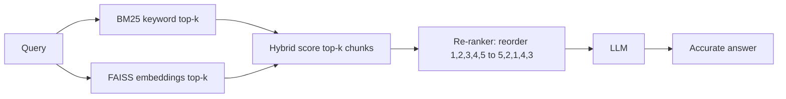

# Reranking in RAG

## Step 1 – The problem 
A retriever (BM25, FAISS/dense, or hybrid) is **fast but shallow**. It returns the top-k chunks, but:
- the best chunk may sit at rank 5, not rank 1
- some chunks are only loosely related (noise)
- the LLM reads all of them, so poor context gives poor answers

**Analogy:** Google gives you 8 links quickly (retrieval). You then read the titles and snippets and pick the best order yourself (reranking). Only then do you write your answer (generation).

## Step 2 – What is reranking?

A **second-stage filter**:
1. A fast retriever fetches top-k documents.
2. A slower but smarter model (cross-encoder or LLM) **re-scores and reorders** them against the query.

Result: the most relevant documents come first, so the LLM answer improves.

## Step 3 – The 3 stages of the pipeline

| Stage | Job | Speed | Accuracy |
|---|---|---|---|
| 1. Retrieval | Cast a wide net (top-k) | Very fast | Medium |
| 2. Re-ranking | Reorder or filter the candidates | Slower | High |
| 3. Generation | LLM answers using the reordered context | – | – |

Key idea: **retrieve wide, rerank narrow.** Rerank only the small top-k set, never the whole corpus.

## Step 4 – Why retrieval alone isn't enough

- **BM25** = exact words. It misses synonyms and meaning.
- **Dense/FAISS** = meaning. It can miss exact terms and rare keywords.
- **Both** score the query and the document *separately* (the query vector and the doc vector are compared). They never read the pair together.
- A **reranker reads the query and the document together**, which gives a much deeper relevance judgement.

## Step 5 – Types of rerankers

| Type | How it works | Pros | Cons |
|---|---|---|---|
| Cross-encoder (e.g. BGE-reranker, MS MARCO MiniLM) | The model sees `[query + doc]` and outputs a score | Accurate, cheap compared with an LLM | Needs a model download or GPU |
| Hosted reranker API (Cohere Rerank) | Same idea, as a service | Easy | Cost, data leaves your system |
| **LLM reranker** (used in the notebook) | A prompt asks the LLM to order the docs | Flexible, no extra model | Slower, costs tokens, output can be malformed |

## Step 6 – Why use a reranker (10 reasons: without vs with)

| # | Aspect | Without reranker | With reranker |
|---|---|---|---|
| 1 | Relevance of context | Loosely related top-k | Re-scored and reordered |
| 2 | Factual accuracy | Hallucination risk | Irrelevant docs filtered, answers grounded |
| 3 | Ambiguity | Retriever lacks deep query understanding | Evaluates the full query–doc pair |
| 4 | Semantic matching | Dense misses low-similarity but relevant docs | Deeper models catch them |
| 5 | Keyword vs meaning | BM25 favours exact match | Balances semantic and lexical |
| 6 | Evidence priority | All docs treated equally | Best evidence floats to top |
| 7 | Long-tail queries | Weak on rare queries | Captures rare but meaningful matches |
| 8 | LLM efficiency | Verbose or wrong answers | Precise, concise answers |
| 9 | Noise | Ads and unrelated text slip in | Noise pushed down or removed |
| 10 | Scoring flexibility | Fixed retriever score | Can add metadata, recency, user preference |
